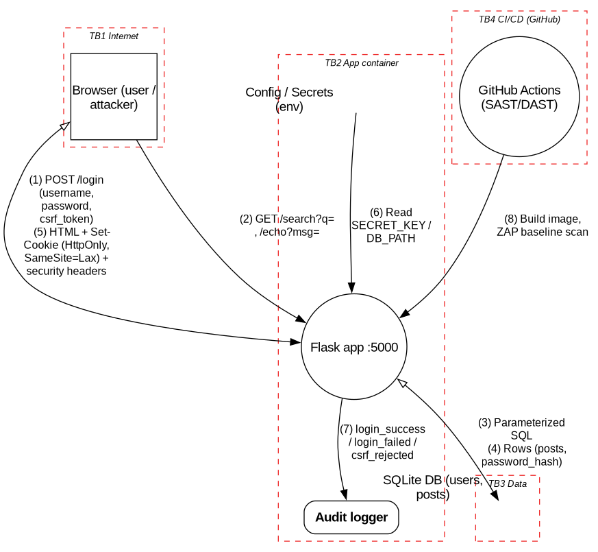

# Модель загроз (STRIDE + DFD)

Методика: Microsoft STRIDE per element, DFD з межами довіри; інструментальна перевірка архітектури —
**OWASP pytm** (threat modeling as code). Оцінка ризику: Likelihood × Impact (1–5) та CVSS 3.1
(див. `risk-register.csv`).

## 1. Контекст і межі довіри

```
            TB1: Internet → застосунок                     TB2: застосунок → дані
 ┌──────────┐  HTTP GET/POST   ┌────────────────────┐  SQL (sqlite3)  ┌──────────────┐
 │ Browser  │ ───────────────▶ │  Flask app (:5000) │ ──────────────▶ │ SQLite DB    │
 │ (user /  │ ◀─────────────── │  /search /echo     │ ◀────────────── │ users, posts │
 │ attacker)│  HTML + cookie   │  /login /profile   │                 └──────────────┘
 └──────────┘                  └─────────┬──────────┘
                                         │ env (SECRET_KEY, DB_PATH)        TB3: CI/CD → runtime
                                         ▼
                                ┌────────────────────┐        ┌────────────────────────────┐
                                │ Config / Secrets   │ ◀───── │ GitHub Actions (SAST/DAST) │
                                └────────────────────┘        └────────────────────────────┘
```

| Елемент | Тип DFD | Категорії STRIDE |
|---------|---------|------------------|
| Browser (користувач / зловмисник) | External entity | S, R |
| Flask app | Process | S, T, R, I, D, E |
| SQLite DB | Data store | T, I, D |
| Config / Secrets | Data store | T, I |
| HTTP-запит/відповідь (TB1) | Data flow | T, I, D |
| SQL-запит (TB2) | Data flow | T, I |
| GitHub Actions | External process | S, T, E |

## 2. STRIDE-матриця

| ID | STRIDE | Елемент | Загроза | Контроль у baseline | Ризик |
|----|--------|---------|---------|---------------------|-------|
| T-S-1 | Spoofing | /login | Перебір / credential stuffing | немає | R3 |
| T-S-2 | Spoofing | cookie | Викрадення / фіксація сесії | лише підпис cookie | R7 |
| T-T-1 | Tampering | SQL flow | SQL-ін'єкція через `q` | немає | R1 |
| T-T-2 | Tampering | /login | Login CSRF | немає | R7 |
| T-T-3 | Tampering | ланцюг постачання | Вразливі залежності | немає | R4 |
| T-R-1 | Repudiation | Flask app | Немає аудиту входів | немає | R8 |
| T-I-1 | Info disclosure | /echo | Відбитий XSS | немає | R2 |
| T-I-2 | Info disclosure | DB | Паролі у відкритому вигляді | немає | R3 |
| T-I-3 | Info disclosure | /search | Показ тексту SQL-запиту | — | R9 |
| T-I-4 | Info disclosure | Config | Жорстко заданий `SECRET_KEY` → підробка сесії | env var з fallback | R6 |
| T-D-1 | DoS | /search | Довгі / важкі `LIKE`-запити | немає | R1/R9 |
| T-EoP-1 | Elevation | /profile | Доступ без автентифікації | перевірка сесії | — |
| T-EoP-2 | Elevation | Flask app | RCE через Werkzeug debugger | немає | R5 |

## 3. Сценарії атак і способи виявлення

### Сценарій 1 — SQL-ін'єкція у `/search` (R1, CWE-89)
- **Кроки:** `GET /search?q=' UNION SELECT id, username, password FROM users--` → на сторінці логіни й паролі.
- **Вплив:** розкриття таблиці `users` (у поєднанні з R3 — паролі у відкритому вигляді).
- **Виявлення:** Bandit B608, Semgrep `tainted-sql-string`; ZAP; регресійний тест; моніторинг `UNION`/`'` у логах.
- **Пом'якшення:** параметризований запит, обмеження довжини, прибрати показ SQL.

### Сценарій 2 — Відбитий XSS у `/echo` (R2, CWE-79)
- **Кроки:** жертва відкриває `/echo?msg=<script>...</script>` → JS виконується в контексті сайту.
- **Виявлення:** Semgrep `raw-html-format`, `directly-returned-format-string`; ZAP; тест екранування.
- **Пом'якшення:** `markupsafe.escape`, CSP, HttpOnly-cookie.

### Сценарій 3 — Перебір паролів (R3, CWE-307/256)
- **Кроки:** скрипт перебирає словник для `alice` на `POST /login` без обмежень.
- **Виявлення:** аудит-лог (серія `login_failed` з одного IP), тест lockout, огляд коду.
- **Пом'якшення:** scrypt-хеші, lockout 5 спроб / 15 хв, однакові повідомлення.

### Сценарій 4 — RCE через Werkzeug debugger (R5, CWE-94)
- **Кроки:** при `debug=True` помилка відкриває інтерактивну консоль Python.
- **Виявлення:** Bandit B201, Semgrep `debug-enabled`.
- **Пом'якшення:** `debug` лише зі змінної оточення, за замовчуванням вимкнено.

### Сценарій 5 — Підробка сесії через відомий `SECRET_KEY` (R6, CWE-798)
- **Кроки:** ключ `hardcoded-dev-secret` у публічному коді → підписати cookie `{'user_id': 1}` → вхід як alice.
- **Виявлення:** кастомне Semgrep-правило, GitHub secret scanning, огляд PR.
- **Пом'якшення:** обов'язковий `SECRET_KEY` з оточення / GitHub Secrets.

## 4. Інструментальний аналіз архітектури (OWASP pytm 1.4.1)

Архітектура описана кодом у `threatmodel/tm.py` (threat modeling as code): 4 межі довіри
(TB1 Internet, TB2 App container, TB3 Data, TB4 CI/CD), 7 елементів (Actor, Server, 2 Datastore,
Process, Lambda) і 8 потоків даних із класифікацією даних (PUBLIC … TOP_SECRET) та атрибутами
контролів (`sanitizesInput`, `encodesOutput`, `implementsCSRFToken`, `usesParameterizedInput` тощо).

```
python threatmodel/tm.py --dfd | dot -Tpng -o docs/dfd.png     # DFD (docs/dfd.png)
python threatmodel/tm.py --json reports/pytm/tm.json          # знахідки
```



### 4.1 Результати

Модель описує стан **після** виправлень (PR #11, #12). pytm зіставив елементи з каталогом
загроз (на основі CAPEC) і згенерував **125 потенційних загроз**: Very High — 13, High — 51,
Medium — 57, Low — 4. Розподіл за ціллю: GitHub Actions — 31, Flask app — 22, потоки даних — 8×7…8,
Audit logger — 8, сховища — по 4.

### 4.2 Тріаж знахідок pytm

| Група (ID pytm) | Ціль | Рішення | Обґрунтування / контроль |
|---|---|---|---|
| DS06 Data Leak (7, Very High) | усі потоки HTTP / env / log | **Прийнято, частково пом'якшено** | у застосунку немає TLS — він термінується на reverse-proxy (припущення моделі); рекомендація REC-1: HSTS + TLS 1.2+ |
| AC17/AC19/AC20 Session hijacking / replay | Flask app | **Пом'якшено** | HttpOnly + SameSite=Lax, `session.clear()` при вході, життя сесії 30 хв; `Secure` — у production |
| CR03 Dictionary-based Password Attack | Flask app | **Пом'якшено** | lockout 5 спроб / 15 хв, scrypt (N=32768) |
| INP26/INP31/INP33 Code / Command injection, RCE | Flask app | **Пом'якшено** | debug вимкнено, немає `eval`/`subprocess`; Bandit = 0 |
| INP28 XSS, INP20 iFrame overlay | Flask app | **Пом'якшено** | autoescape + `escape()`, CSP `frame-ancestors 'none'`, X-Frame-Options DENY |
| AC21 CSRF | CI / app | **Пом'якшено** | CSRF-токен + `hmac.compare_digest` |
| DR01 Unprotected Sensitive Data (7) | потоки з даними SECRET/TOP_SECRET | **Залишковий ризик (Medium)** | SQLite не шифрується at rest → REC-10 (шифрування тому / SQLCipher) |
| DE04 Audit Log Manipulation | Audit logger | **Залишковий ризик (Medium)** | лог у stdout контейнера → REC-8 (централізований append-only лог, SIEM) |
| AC23 Credentials Disclosure, CR06 Channel manipulation | env, CI | **Пом'якшено / прийнято** | секрети не в коді й образі (коміт 9a77d9f), GitHub Secrets; TLS у GitHub |
| INP02/INP07/INP12/INP24 Buffer overflow, INP22/INP32 XML | CI, app | **Не застосовно** | Python (керована пам'ять), XML не обробляється |
| AC14, AC15, SC05 та ін. (generic для Process) | GitHub Actions | **Прийнято** | процес CI ізольований раннером GitHub, права workflow мінімальні (`contents: read`, `security-events: write`) |

Висновок: жодна Very High/High загроза pytm не залишилась без контролю чи обґрунтованого рішення;
залишкові ризики (DS06, DR01, DE04) винесені в рекомендації аудиту.

## 5. Виявлені ризики / знахідки (зведення)

| Джерело | Baseline | Після PR #11 | Після PR #12 + 9a77d9f |
|---|---|---|---|
| Semgrep + Bandit + pip-audit (гейт) | 21 знахідка, **10 blocking** | 3 blocking | **0 blocking**, 1 false positive (dismissed) |
| GitHub Code scanning | 19 open | — | 19 fixed, 1 dismissed, 0 open |
| ZAP baseline | WARN 13 (4 Medium, 6 Low) | — | WARN 7 (0 Medium, 1 Low, 6 Info) |
| pytm | — | — | 125 потенційних, 3 групи залишкових ризиків |

| Ризик | Статус | Як закрито |
|---|---|---|
| R1 SQLi | Closed (#2, PR #11) | параметризований запит |
| R2 XSS | Closed (#3, PR #11) | `escape()` + CSP |
| R3 Слабка автентифікація | Closed (#5, PR #12) | scrypt + lockout |
| R4 flask 3.0.3 | Closed (#7, PR #12) | flask 3.1.3 |
| R5 debug=True | Closed (#4, PR #11) | debug із env, off |
| R6 SECRET_KEY | Closed (#6, PR #12, 9a77d9f) | обов'язковий env, прибрано з Dockerfile/compose |
| R7 cookie/headers/CSRF | Closed (#8, #9, PR #12) | прапорці, заголовки, токен |
| R8 аудит | Closed (PR #12) | `audit` logger |
| R9 показ SQL | Closed (#10, PR #11) | прибрано з шаблону |
| R10 bind 0.0.0.0 | Closed (PR #11) | host із env, 127.0.0.1 |
| RR1 Server: Werkzeug | **Open (Low)** | dev-сервер; у production — gunicorn + nginx `server_tokens off` |
